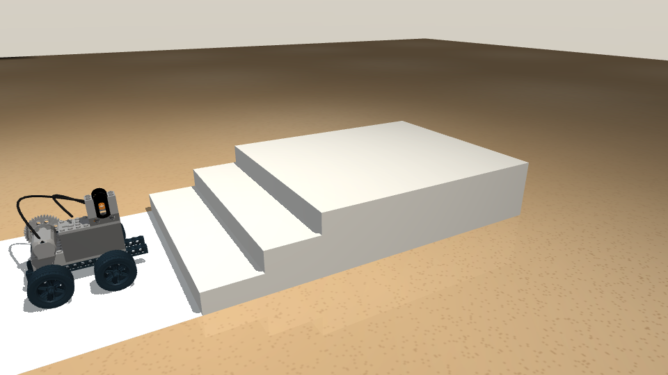
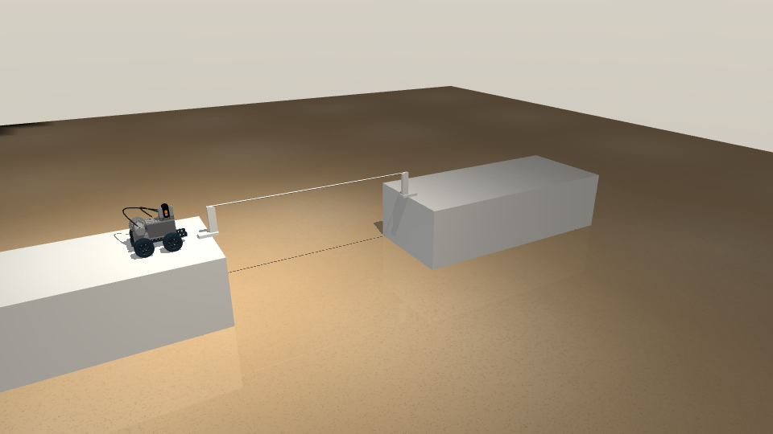
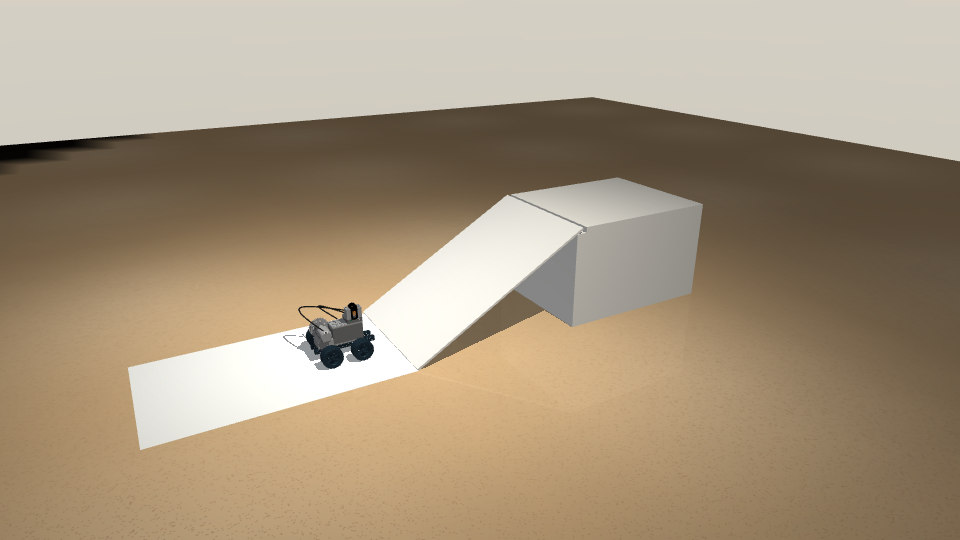
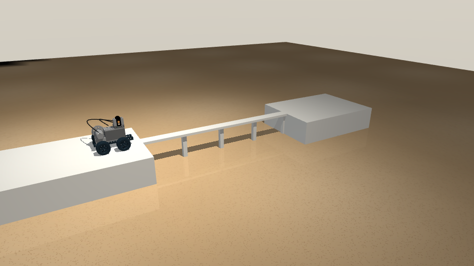
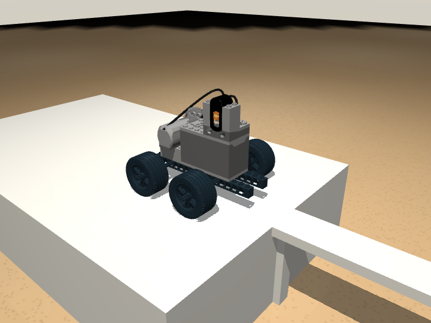
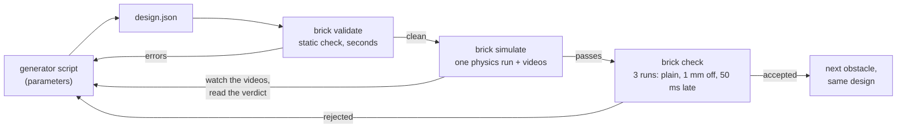

# Challenge Problem 3: The Brick Obstacle Course

**New here? Start with [`HANDOUT.pdf`](HANDOUT.pdf)**: a short guide to setup, a first run and reading your results.
This README is the full reference.

A small workshop has a box of LEGO Technic parts, a few Power Functions motors and battery boxes, and an IR receiver
for the remote control. It also has an obstacle course: a staircase, a rope stretched across a chasm, a steep ramp up
to a plateau and a narrow plank over a drop.

**Your task: design one LEGO vehicle that gets across as many of the four obstacles as possible: Steps, Rope, Ramp and
Bridge.**

The leaderboard ranks designs first by the number of obstacles passed, and then, among designs that pass the same
number, by the total time. An obstacle counts as passed only when `brick check` accepts the design on it (all three
simulated runs pass, see below); the total time is the sum of the plain run's `time_s` over the obstacles passed.
Designs that pass the same number of obstacles in the same total time (for example, designs that pass none) are tied.

`python score design.json` checks your design on all four obstacles and shows the result as a web page (see
[Score and results dashboard](#score-and-results-dashboard)). We will evaluate every submitted design independently,
by re-running `brick check` on all four obstacles on our own machine; that result is your official score.

Every vehicle is a design file, and a calibrated physics simulator drives it over the course. You can only use the
parts in the workshop's inventory, and every design must include the IR receiver. You can write the design file by
hand, but we highly recommend using a coding agent backed by a large language model to understand the obstacles and
write the design. Every student has $200 of credit on MIT's Parley platform; see the last section for instructions.

## The four obstacles

| Steps | Rope |
| :---: | :---: |
|  |  |
| Climb three 28.8 mm steps onto a top deck 86.4 mm high<br>**Time limit: 64.3 s** | Ride a 3 mm cord across a 600 mm chasm<br>**Time limit: 37.2 s** |
| **Ramp** | **Bridge** |
|  |  |
| Climb a 30° board onto a plateau 233.6 mm high<br>**Time limit: 36.7 s** | Cross a 640 mm plank, 40 mm wide, over a 99.2 mm drop<br>**Time limit: 31.0 s** |

Each picture shows the example vehicle from `example_design.json` on the start line. It is there to show the file
format, not a solution.

A few details that the pictures do not show:

- **Ramp**: the slope is a 460 mm foam-core board (150 g) hinged at the plateau edge with its foot resting on the
  floor. It is a loose, moving body in the simulation, not a fixed slope: a vehicle that pushes it hard can shift it.
- **Rope** and **Bridge**: the start and goal decks are raised above a chasm floor. Touching the chasm floor with any
  part of the vehicle fails the run, even if the vehicle could climb back out.
- The vehicle must reach the goal within the course's time limit, shown under each picture; `python brick task <bench>`
  prints it (`time_limit_s`) with the rest of the geometry.

## How a run is judged

A run **passes** when every part of the vehicle is inside the goal region within the time limit and the vehicle is
upright and in one piece. After the vehicle first reaches the goal it is watched for 5 more seconds: if in that time
the chassis tilts more than 30° from its start attitude for over 0.3 s (`tipped over after crossing`), or any of the
failures below happens, the run fails. The run's `time_s` is the moment it first reached the goal; the 5 s are not
counted. A run fails as soon as one of these happens:

| Failure | Meaning |
| --- | --- |
| `fell` | the chassis drops below the course's fail height |
| `touched chasm floor` | any part touches the floor of the chasm (rope and bridge only) |
| `flipped` | the vehicle tilts more than 75° for 0.5 s |
| `left_lane` | the chassis leaves the lane (±152 mm from the centre line; ±100 mm on the rope) |
| `broke` | a part moves more than 15 mm from where the design puts it, or a stud joint pulls apart |
| `stuck` | progress improves by less than 5 mm in 4 s |
| `timeout` | the time limit runs out |

`fell`, `flipped` and `left_lane` are judged on the part you name as `chassis` (see below), so choose a part that is
rigidly fixed to the main frame of the vehicle.

One lucky run is not enough. `brick check` **accepts** a design on a bench only when all of the following hold:

1. `brick validate` is clean: every part is in the inventory, nothing collides, every connection is real, and the
   design has at most 400 pieces;
2. the design review has no critical finding;
3. three simulated runs all pass:
   - the **plain** run;
   - the vehicle placed **1 mm off the centre line**;
   - every motor command whose `t` is later than the first command's `t` sent **50 ms late** (commands at the same
     time as the first are not delayed).

The last two runs check that the design is robust and has not been tuned to one exact trajectory. Even in the plain
run, every command reaches the motors about 35 ms after its `t`, like a real IR remote.

`brick validate` prints `"ok": true` when step 1 passes, but step 2 is reported separately under `review`: a design
with `"ok": true` and a non-empty `review.critical` list is still rejected by `brick check`. Entries under
`review.warnings` do not block acceptance, but they often point to the cause of a failed run; the example design itself
has five of them (gears that can slide along their axles).

## What a design is



*The example vehicle: 20 pieces and 261 g. A PF M-motor drives the rear axle through a 20T bevel and a 24T gear; the
IR receiver sits on top of a AAA battery box.*

A design is one JSON file (`example_design.json` is a complete one). It lists:

- **`parts`**: every piece, with its inventory id, position in mm (x forward, y left, z up) and rotation;
- **`connections`**: how the pieces are joined (`stud`, `pin`, `hinge`, `cross` axle or `motor`);
- **`gear_meshes`**: which gears engage;
- **`chassis`**, **`motor`** and **`battery`**: the names of those parts (the chassis is the part the judge tracks
  for `fell`, `flipped` and `left_lane`);
- **`motor_program`**: what the IR remote sends during the run.

Every design needs the IR receiver `58123c01`, a battery box and at least one motor. Each IR receiver has two
outputs, and you own two receivers. Every motor that follows its own sequence of levels needs its own output; two
motors can share one output only if they must turn the same way at the same speed for the whole run. The inventory (`inventory.md`)
lists what you can use and how many of each: Technic bricks, beams, plates, axles, pins, gears, racks, differentials,
shock absorbers, wheels and sprockets, chain and tread links, and the motors below.

| Motor | Owned | Rating |
| --- | :---: | --- |
| PF M-motor `58120c01` | 2 | 400 rpm, 0.15 N m stall |
| PF L-motor `99499c01` | 2 | 390 rpm, 0.18 N m stall |
| PF XL-motor `58121c01` | 2 | 220 rpm, 0.40 N m stall |
| PF servo `99498c01` | 2 | ±90°, 0.10 N m |
| Pullback motor `12787c01` | 2 | spring motor, not IR controlled |

### The motor program

The vehicle drives **open loop**: there is no steering and no sensing, only a timed list of commands, as if someone
pressed buttons on the IR remote at fixed times. A level runs from -7 to 7 (speed steps), or `"brake"`:

```json
"motor_program": [
  {"t": 0.0, "motor": "motor", "level": 1},
  {"t": 0.3, "motor": "motor", "level": 4},
  {"t": 0.6, "motor": "motor", "level": 7},
  {"t": 4.0, "motor": "motor", "level": "brake"}
]
```

Your one design, and therefore its one `motor_program`, runs on all four obstacles. The same timed commands have to
work on the steps, the rope, the ramp and the bridge, so plan your control as carefully as the mechanism.

> **Use only `t` triggers.** The validator also accepts relative triggers such as `"after"` / `"delay"`, but the
> simulator ignores them: a command without `t` fires at the very start of the run. After a run, read
> `motor_program_log` in the output to see when each command actually fired.

### Writing a design with the `bricks` library

Write the design with a generator script so that parameters are easy to change between runs:

```python
from bricks.design import Design, DesignPart, DesignConnection, validate, Budget, place
from bricks.parts import bench_parts, inventory_part_set

d = Design.load("example_design.json")
d.parts.append(DesignPart("w", "56145c01", (0, 30, 21.6), yaw_deg=0))
rep = validate(d, Budget.for_part_set("inventory"))
print(rep.ok, rep.errors, rep.warnings, rep.stats)   # stats: mass, size, clearance, gear ratio, expected speed...
                                                     # here rep.ok is False: the new wheel "w" is not on an axle
P = place(d)                                         # name -> world pose, axes, bounding box
d.save("candidate.json")

bench_parts()["3895"]    # one part: kind, mass_g, shape, studs_top, studs_bottom, holes, pin_holes, teeth, wheel_radius, tyre_mu, notes
inventory_part_set()     # part id -> count owned
```

The snippet adds a wheel without an axle on purpose, to show what the errors look like. Note that the library's
`validate()` checks less than `brick validate`: it does not apply the 400-piece limit, the IR receiver and motor
requirements, the start gap or the course's own constraints, and it does not run the design review. Always confirm a
candidate with `python brick validate` before simulating it.

The fields of a design:

- `parts`: `{"name", "part", "pos_mm": [x, y, z], "yaw_deg", "spin_deg"}`. x is forward, y left, z up, in mm. The
  rotation is yaw about z, then spin about the part's own y axis. `name` is your own label for the piece and is what
  `connections`, `gear_meshes`, `chassis`, `motor` and `motor_program` refer to; `part` is the inventory id.
- `connections`: `{"child", "parent", "kind"}`, with `kind` one of `stud` (add `"studs": n`), `pin`, `hinge`, `cross`,
  `motor`.
- `gear_meshes`: `{"gear_a", "gear_b", "teeth_a", "teeth_b"}`.
- `chassis`, `motor`, `battery`: names of those parts. Keep `"part_set": "inventory"`.
- `motor_program`: timed open-loop commands, `{"t": seconds, "motor": name or "all", "level": -7..7 or "brake"}`.
  `motor` is the `name` of a motor part in your design (in the example the motor part happens to be named `"motor"`),
  not its type. A command may carry a free-text `"note"`, which is ignored.
- `start_gap_mm` (optional): distance from the front of the vehicle to the obstacle's start line. Leave it out to use
  the course's default (30 mm on steps and bridge, 38 mm on ramp, 60 mm on rope). The whole vehicle must still fit on
  the start board behind the line; `brick validate` tells you if it does not.
- Optional mechanism lists: `chains`, `treads`, `racks`, `differentials`, `cv_joints`, `pullback`.

Grid: stud pitch 8 mm, brick 9.6 mm tall, plate 3.2 mm. `brick validate` names anything that does not fit.

**Where is a part's origin?** `pos_mm` places the part's own origin, which is not always its centre:

- bricks, plates and the AAA battery box: the top centre of the body (the studs stick up above z = 0), so a 2x4 brick
  at `z = 9.6` sits on the floor;
- Technic brick holes run along the part's y axis, 4 mm below the top surface;
- axles and pins: centred, along the part's x axis;
- gears, wheels and bushes: centred, with the rotation axis along the part's y axis;
- PF motors: on the output axis at the output face, with the body along +y.

When in doubt, read the part's `shape` (its bounding box in its own frame) with `bench_parts()[id].shape`, or call
`place(d)` and look at where each part actually ends up.

The repository contains:

```
HANDOUT.pdf          short guide: setup, first run, reading results
brick                command-line tool
score                checks a design on all four obstacles and writes the results dashboard
inventory.md         every part owned: id, name, count, size
example_design.json  a complete, valid design
tasks/<bench>.json   the four courses
docs/images/         the pictures in this README
simulator/           csim.py, run_csim.py, params_v14.json, part meshes
src/bricks/          the design library (import from here)
src/ai_pd_tasks/     the code behind it: src/bricks/* are thin aliases of src/ai_pd_tasks/lego_bench/*,
                     so read the source there
```

## The workflow



1. **Write a generator script** that builds the design from a few parameters (wheel size, wheelbase, gear ratio,
   timings...) using the `bricks` library, so you can change one number and rebuild.
2. **`python brick validate design.json steps`** checks the design in seconds and prints its stats: mass, size,
   clearance, gear ratio and expected speed.
3. **`python brick simulate design.json steps`** runs the physics once. It prints a JSON verdict (`passed`, `failure`,
   `max_progress`, `time_s`, `broken_joints`, ...) and writes `_sims/<run>/` next to the design, with a follow video,
   an overview video and a contact sheet of each. **Watch the videos**: they tell you why a run failed far better than
   the verdict does.
4. **`python brick check design.json steps`** runs the acceptance check once the design passes on its own.
5. **Repeat for every obstacle with the same `design.json`.** A change that fixes one obstacle can break another, so
   re-check all four before you submit:

   ```bash
   python score design.json --open
   ```

   This runs the same check as `python brick check design.json <bench>` for each of the four benches and builds the
   results dashboard (next section).

## Score and results dashboard

```bash
python score design.json --open
```

`score` runs `brick check` on all four obstacles (three simulations each, two obstacles at a time on most laptops)
and prints how long it expects to take, usually a few minutes. It then writes two files next to the design:

- `results.html`, a dashboard to open in a browser: your score, a row per obstacle with its time and how far the
  vehicle got, and for each obstacle the three runs, a plain-English explanation of what went wrong and the video;
- `results.json`, the same data.

The score is the number of obstacles crossed and the total time over them, ranked as described at the top. To
re-check only some obstacles after a change, add `--courses` (for example `--courses rope,bridge`); the others keep
their last result. A result that was checked with an older version of `design.json` is marked **Outdated** and does
not count until you re-check it.

`score` is a preview. We will evaluate every submitted design independently, by re-running `brick check` on all four
obstacles on our own machine, and that result is your official score. Simulation results can differ slightly from one
computer to another, so a design that only just passes may not pass on ours: leave some margin.

Bench names for the commands are `steps`, `rope`, `ramp` and `bridge`. `python brick task <bench>` prints a course's
exact geometry, start, goal and time limit.

## Installation

### 1. Install uv and ffmpeg (once)

macOS:

```bash
brew install uv ffmpeg
```

Linux:

```bash
curl -LsSf https://astral.sh/uv/install.sh | sh
sudo apt install ffmpeg
```

Windows (PowerShell):

```powershell
winget install --id=astral-sh.uv -e
winget install --id=Gyan.FFmpeg -e
```

Open a new terminal afterwards so that `uv`, `ffmpeg` and `ffprobe` are on `PATH`; check with `uv --version` and
`ffmpeg -version`. You do not need to install Python 3.12 yourself: `uv` downloads it if it is missing.

### 2. Create the environment (once, in the repository folder)

```bash
uv venv --python 3.12 .venv
uv pip install -r requirements.txt
```

### 3. Activate it (in every new terminal)

macOS / Linux:

```bash
source .venv/bin/activate
export PYTHONPATH=$PWD/src            # for `import bricks`
```

Windows (PowerShell):

```powershell
.venv\Scripts\activate
$env:PYTHONPATH = "$PWD\src"          # for `import bricks`
```

If PowerShell refuses to run the activation script, allow local scripts once with
`Set-ExecutionPolicy -Scope CurrentUser RemoteSigned`. In `cmd.exe`, use `.venv\Scripts\activate.bat` and
`set PYTHONPATH=%CD%\src`.

Once the environment is active, `python` is the environment's Python 3.12. If you see `No module named 'mujoco'`, the
environment is not active in this terminal.

### 4. Try it

```bash
python brick list                                # the benches
python brick validate example_design.json ramp   # static check (fast)
python brick simulate example_design.json ramp   # one physics run, about half a minute
python score example_design.json --open          # all four obstacles and the dashboard, a few minutes
```

These commands are the same on macOS, Linux and Windows.

### Rendering

Videos render through MuJoCo. The default is `MUJOCO_GL=egl` on Linux (headless, needs a GPU driver with EGL) and
`MUJOCO_GL=glfw` on macOS and Windows, where MuJoCo does not allow EGL. Set `MUJOCO_GL` yourself to override it. On
Windows, rendering needs a logged-in desktop session with a working graphics driver. On a Linux machine without a GPU,
install OSMesa (for example `sudo apt install libosmesa6`) and set `export MUJOCO_GL=osmesa`; rendering is then slower
but works.

`brick simulate`, `brick check` and `score` also need `ffmpeg` and `ffprobe` on `PATH` to write the videos and contact
sheets.

If a run reports `the simulator produced no result`, read `_sims/<run>/sim.log`. Graphics errors there (GLFW, OpenGL,
EGL) point to the machine's setup, not to your design.

## Using an AI coding agent (Parley API)

Designing a vehicle means writing a generator script, running the simulator, watching the videos and changing the
design again, many times over. A coding agent can do much of that loop with you. We recommend
[Claude Code](https://docs.claude.com/en/docs/claude-code/overview) or
[Codex](https://developers.openai.com/codex), both run through MIT's Parley API.

### 1. Get a Parley API key

Sign in at **<https://platform.parley.mit.edu>** and create an API key. It starts with `sk-parley-`. Treat it like a
password: do not paste it into notebooks, scripts or anything you commit to Git.

### 2. Install Claude Code

macOS / Linux:

```bash
curl -fsSL https://claude.ai/install.sh | bash
```

Windows (PowerShell):

```powershell
irm https://claude.ai/install.ps1 | iex
```
For Codex, see the [Codex website](https://developers.openai.com/codex) for installation.

### 3. Point Claude Code at Parley

Claude Code reads its settings from `settings.json` in your home folder:

| System | File |
| --- | --- |
| macOS / Linux | `~/.claude/settings.json` |
| Windows | `%USERPROFILE%\.claude\settings.json` |

Create the file (and the `.claude` folder) if it does not exist yet, and put your key in it:

```json
{
  "env": {
    "ANTHROPIC_BASE_URL": "https://parley.api.mit.edu",
    "ANTHROPIC_AUTH_TOKEN": "YOUR_API_KEY",
    "ANTHROPIC_MODEL": "bedrock/claude-sonnet-5-5"
  }
}
```

Replace `YOUR_API_KEY` with your Parley key.

If the file already has other settings, add the `"env"` block next to them instead of replacing the file. Note that
the base URL has no `/v1` at the end: Claude Code adds it itself.

We recommend starting with a cheaper model such as Sonnet 5.5 (`bedrock/claude-sonnet-5-5`), since everyone has $200
of credit. If you are still stuck after many attempts, switch to a stronger model such as Opus 5.5 by setting
`ANTHROPIC_MODEL` to `bedrock/claude-opus-5-5`. Keep an eye on your credit usage on Parley.

### 4. Check it

Open a new terminal in the repository folder and start Claude Code:

```bash
claude
```

Inside it, run `/status`: the API endpoint should be `https://parley.api.mit.edu`. If Claude Code asks you to log in,
the settings file was not found or is not valid JSON; check its location and its commas and quotes. To get going, ask
it, for example, to read this document and `inventory.md` and explain the format of `example_design.json`.
